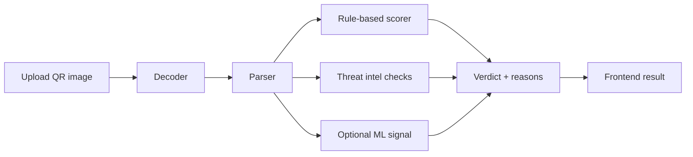

# QuishGuard

QuishGuard analyzes QR codes before the user opens them, classifies the payload, and gives a Safe / Suspicious / Malicious verdict with plain-language reasons.

## Problem statement

QR codes are commonly used for payments, login flows, and URLs, but they can also hide malicious destinations. Many users scan a QR code and immediately open the linked page without checking whether the destination is trustworthy. QuishGuard addresses this by decoding the QR payload locally, extracting the relevant fields, and running lightweight security checks before any redirect or page render occurs.

## Scope

In scope:
- UPI payment QR codes
- Login/session QR links such as WhatsApp Web or SSO-style flows
- General URL QR codes

Out of scope (Future Work only):
- Tampered-sticker image forensics
- A live verified-merchant database
- Mobile app support
- Docker deployment
- User accounts

## One-line pitch

A small, explainable QR security scanner that decodes payloads locally and flags suspicious or malicious destinations before any browser navigation occurs.

## Architecture



## How detection works

| Signal | Why it matters |
| --- | --- |
| QR decoding | Extracts the actual payload without opening the destination |
| UPI parsing | Detects malformed VPA or suspicious payment parameters |
| Login/session heuristics | Known flows like WhatsApp Web and SSO can be impersonated |
| Domain analysis | IPs, shorteners, and hyphenated lookalikes often indicate phishing |
| Brand similarity | Lookalike domains mimic trusted services to fool users |
| WHOIS age | New domains are often used for short-lived phishing pages |
| SSL validation | Missing or weak certificates increase risk |
| Redirect expansion | Hidden destinations can be revealed without fetching page content |
| Threat intel | VirusTotal and Safe Browsing provide external reputation context |
| Optional ML signal | Adds another risk estimate based on URL features |

## Quick start

### 1) Install dependencies

```powershell
cd quishguard
E:/python.exe -m pip install -r requirements.txt
```

### 2) Set environment variables

Copy the example file and add any real API keys you want to use:

```powershell
copy .env.example .env
```

Then populate the keys you choose to enable:

```env
VT_API_KEY=
GOOGLE_SAFE_BROWSING_KEY=
```

### 3) Run the API

```powershell
E:/python.exe -m uvicorn app.main:app --reload
```

### 4) Open the frontend

Open the browser at:

```text
http://localhost:8000/
```

### 5) Test the decoder CLI

```powershell
E:/python.exe -m app.decoder samples/legit.png
```

## Sample usage

### Scan a QR in the browser

1. Open the frontend in a browser.
2. Upload one of the sample QR images in the `samples/` folder.
3. View the verdict, score, reasons, extracted fields, and skipped checks.

### Example payloads

- Legit: `https://example.com/scan`
- Lookalike phishing: `https://paytm-secure-login-verify-kyc.com/verify`
- UPI: `upi://pay?pa=alice@upi&pn=Alice%20Sharma&am=499&cu=INR`

## Sample QR images

The project includes the following sample QR images:

- `samples/legit.png` — benign website QR
- `samples/lookalike.png` — suspicious lookalike domain QR
- `samples/upi.png` — legitimate-looking UPI QR for a small payment

Screenshots placeholder:
- Screenshot 1: Dashboard with Safe verdict
- Screenshot 2: Suspicious or malicious verdict panel
- Screenshot 3: API JSON response example

## Limitations

- This is a proof-of-concept scanner, not a full commercial product.
- It does not perform sticker-image forensics or device-level mobile analysis.
- It relies on lightweight checks and public reputation feeds, which may be incomplete or rate-limited.
- Domain age and SSL checks are intentionally conservative, not authoritative.

## Future work

- Tampered-sticker image forensics and physical QR validation
- Verified merchant or payment database integration
- Better false-positive tuning for login and UPI flows
- Additional threat-intel providers and caching
- CI/CD pipeline with automatic test execution

## Final checklist

- Tests pass
- No secrets committed
- Sample QR assets included
- Frontend uploads and scans successfully
- Clean-clone setup instructions are documented

## Notes for viva defense

This project chooses a transparent, rule-based approach because it is explainable, audit-friendly, and easy to defend in an academic setting. The system never opens the destination URL or renders fetched content; it only decodes the payload, extracts useful metadata, and applies layered checks. That makes it safer by design and easier to justify in a cyber security review.
